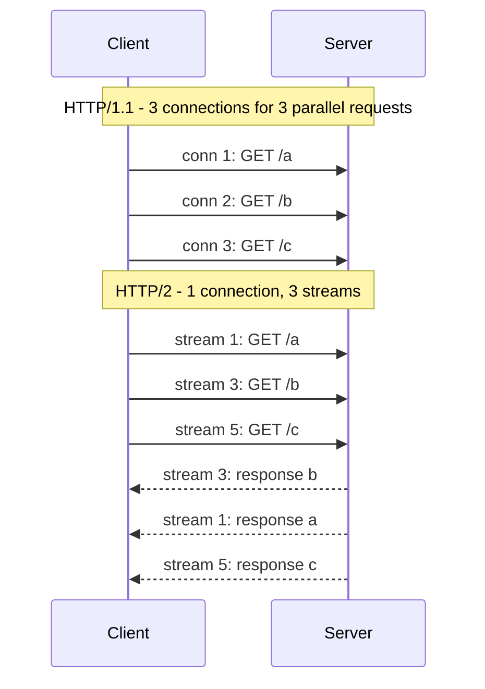
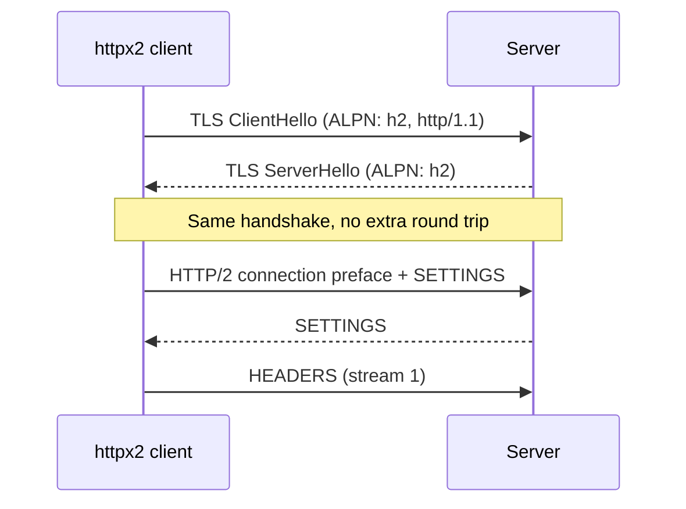
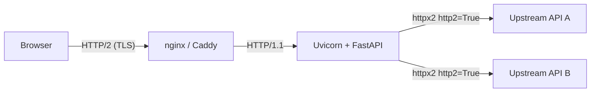

# HTTP/2 in Python with httpx2: What It Really Means for Async FastAPI

Most FastAPI developers type `await client.get(...)` a hundred times a day and never ask what happens on the wire. In my [Robust HTTP Client](https://kfir-g.dev/blog/blogs/2026-02-25_robust-http-python-guide/) post I put `http2=True` in a code sample and moved on. This post explains what that flag does, when it helps, and where it does nothing.

I'm using **httpx2**, the fork of `httpx 0.28.1` maintained under Pydantic. The API is the same, and the main change is the name.

## 1. What Is HTTP/2, Really?

HTTP/2 does **not** change what a request or response means. A `GET /users` is still a `GET /users`, with the same methods, status codes, and headers. What changes is how the bytes travel.

| | HTTP/1.1 | HTTP/2 |
|---|---|---|
| **Format** | Text | **Binary frames** |
| **Concurrency** | One request at a time per connection | **Many streams on one connection** |
| **Headers** | Sent in full every time | **Compressed (HPACK)** |
| **To go parallel** | Open more TCP connections | Reuse the same one |
| **Spec** | [RFC 9112](https://www.rfc-editor.org/rfc/rfc9112) | [RFC 9113](https://www.rfc-editor.org/rfc/rfc9113) |

The key idea is **multiplexing**. HTTP/1.1 needs a separate TCP connection for every concurrent request. HTTP/2 splits each request into frames tagged with a stream ID, so one TCP connection carries many requests at once.



Responses can come back in any order, so a slow `/a` no longer blocks a fast `/b`. That removes **HTTP-level head-of-line blocking**.

> **A caveat most blogs skip:** HTTP/2 still runs on TCP. If one TCP packet is lost, *every* stream on that connection waits for the retransmit. HTTP/3 fixes this by moving to QUIC over UDP, but that is a different post.

## 2. HTTP in Python: Where Does HTTP/2 Fit?

| Library | Sync | Async | HTTP/2 client |
|---|---|---|---|
| `urllib` / `http.client` | Yes | No | No |
| `requests` | Yes | No | No |
| `aiohttp` | No | Yes | No |
| `httpx` / **`httpx2`** | Yes | Yes | **Yes (opt-in)** |

If you want HTTP/2 from Python today, `httpx`/`httpx2` is the practical choice.

HTTP/2 is **not enabled by default**. The httpx2 docs say the HTTP/1.1 implementation is the more battle-hardened one, and that a future version may flip the default. I think that is the right call. It is opt-in, and you opt in when you have a reason.

## 3. Enabling It in httpx2

```shell
pip install 'httpx2[http2]'
```

```python
import httpx2

async with httpx2.AsyncClient(http2=True) as client:
    r = await client.get("https://example.org/")
    print(r.http_version)  # "HTTP/2" or "HTTP/1.1"
```

The extra installs the HTTP/2 dependencies. `Client` and `AsyncClient` both support it, but it pays off mostly in async code with many concurrent requests.

### `http2=True` Is a Request, Not a Guarantee

Both sides must speak HTTP/2. If the server only knows HTTP/1.1, httpx2 silently falls back. The client and server agree during the TLS handshake using **ALPN** (Application-Layer Protocol Negotiation):



If the server answers `http/1.1` instead, you get a normal HTTP/1.1 connection. **Always verify with `response.http_version`**, and log it while you are testing, because a fallback produces no error.

## 4. The FastAPI Trap: Which Leg Is HTTP/2?

This is the part most people get wrong. A FastAPI app has **two** HTTP legs:

1. **Inbound**: the browser or client calling your FastAPI app.
2. **Outbound**: your FastAPI app calling other services with httpx2.

`httpx2` only controls the **outbound** leg. The inbound leg depends on your server. As I covered in [How Uvicorn Listens on a Port](https://kfir-g.dev/blog/blogs/2026-01-29_how-uvicorn-listens-on-a-port/), **Uvicorn speaks HTTP/1.1 only**. If you want HTTP/2 inbound, you have three options:

- Terminate HTTP/2 at a reverse proxy (nginx, Caddy, an ALB) and talk HTTP/1.1 to Uvicorn.
- Run an ASGI server with HTTP/2 support, such as **Hypercorn** or **Granian**.
- Do nothing, if your clients are internal services that don't care.



Each arrow can be a different HTTP version. For a service that fans out to many upstreams, the outbound arrows are usually where HTTP/2 gives the biggest win.

## 5. HTTP/2 Client in Async FastAPI

Create **one** client for the whole app and share it through `lifespan`, as in [Part 4 of my FastAPI series](https://kfir-g.dev/blog/blogs/2025-12-25_From-Passive-FastAPI-Developer-to-Real-FastAPI-Engineer--Part-4/). A new client per request throws away the connection reuse that makes HTTP/2 worthwhile.

```python
import asyncio
from contextlib import asynccontextmanager

import httpx2
from fastapi import FastAPI, Request

UPSTREAM = "https://api.internal.example"  # any HTTP/2-capable server


@asynccontextmanager
async def lifespan(app: FastAPI):
    app.state.http = httpx2.AsyncClient(
        http2=True,
        timeout=httpx2.Timeout(10.0, connect=5.0),
    )
    yield
    await app.state.http.aclose()


app = FastAPI(lifespan=lifespan)


@app.get("/fan-out")
async def fan_out(request: Request):
    client: httpx2.AsyncClient = request.app.state.http
    urls = [f"{UPSTREAM}/items/{i}" for i in range(20)]

    responses = await asyncio.gather(*(client.get(u) for u in urls))

    return {
        "http_versions": sorted({r.http_version for r in responses}),
        "statuses": [r.status_code for r in responses],
    }
```

With `http2=True` and an HTTP/2 upstream, those 20 requests share **one TCP + TLS connection**. With HTTP/1.1, the pool opens several connections, each with its own handshake, to run them in parallel.

Servers advertise a `MAX_CONCURRENT_STREAMS` limit, often around 100. Past that limit, extra requests wait for a free stream, so your concurrency is capped by the server's setting and not only by your code.

### Measure It Yourself

Don't trust a blog's numbers, including mine. Test against your own upstream:

```python
import asyncio
import time

import httpx2

URL = "https://your-http2-server.example/get"
N = 50


async def bench(http2: bool) -> float:
    async with httpx2.AsyncClient(http2=http2) as client:
        await client.get(URL)  # warm up the connection
        start = time.perf_counter()
        rs = await asyncio.gather(*(client.get(URL) for _ in range(N)))
        elapsed = time.perf_counter() - start
        print(f"http2={http2} -> {rs[0].http_version}, {elapsed:.3f}s")
        return elapsed


async def main():
    await bench(False)
    await bench(True)


asyncio.run(main())
```

## 6. When HTTP/2 Helps and When It Doesn't

| Situation | HTTP/2 helps? |
|---|---|
| Many concurrent requests to the **same host** | **Yes** |
| Large headers repeated on every call (cookies, auth tokens) | **Yes** (HPACK) |
| One sequential request now and then | No |
| Upstream only speaks HTTP/1.1 | No (falls back) |
| Very lossy network | Partly (TCP head-of-line blocking) |
| Requests spread across many different hosts | Little |

Quick rule: use `http2=True` when your service **fans out concurrent calls to a few hosts**, and leave it off when you make occasional single calls.

## 7. Migrating to httpx2

If you already use `httpx`, the migration is small:

1. Replace `httpx` with `httpx2` in your dependencies.
2. Replace `import httpx` with `import httpx2`.

For a first pass in a big codebase, alias it:

```python
import httpx2 as httpx
```

Things worth knowing:

- **Both packages can be installed together.** You can migrate module by module.
- **Their objects don't mix.** `httpx.Client` and `httpx2.Client` are different classes, so `isinstance` checks and `except httpx.HTTPError` won't cross the boundary. The package that receives the object decides which module you build it from.
- **`alias_httpx()`** makes `import httpx` resolve to `httpx2` process-wide. Call it first, in your app entrypoint only, never in a library.
- **SSL verification** now uses the **OS trust store** (via `truststore`) instead of `certifi`. This usually means fewer corporate-proxy problems.
- **Logger names** change to `httpx2` and `httpcore2.*`, and the default `User-Agent` becomes `python-httpx2/<version>`.
- **Python 3.10+** is required.
- **Built in:** Server-Sent Events (`client.sse()`) and WebSockets (the `httpx2[ws]` extra), so you can drop `httpx-sse` and `httpx-ws`.

## Helpful Tools

- **[HTTP/2 explained](https://http2-explained.haxx.se/)**: Daniel Stenberg's free book, linked from the httpx2 docs.
- **`curl --http2 -v`**: shows the ALPN negotiation as it happens.
- **[Hypercorn](https://hypercorn.readthedocs.io/)** / **[Granian](https://github.com/emmett-framework/granian)**: ASGI servers with HTTP/2.
- **Chrome DevTools, Network tab, "Protocol" column**: shows `h2` or `http/1.1` per request.

## Summary

HTTP/2 keeps the same HTTP semantics and changes the transport: binary frames, multiplexed streams, and compressed headers over one TCP connection. In httpx2 you opt in with `http2=True` and check `response.http_version`, because the client falls back to HTTP/1.1 without raising an error. In FastAPI, httpx2 only covers the **outbound** leg, so HTTP/2 inbound needs a proxy or an HTTP/2-capable server such as Hypercorn. Share one `AsyncClient` through `lifespan`, fan out with `asyncio.gather`, and **measure** before assuming a speedup.

<meta name="fediverse:creator" content="@kg@fosstodon.org">