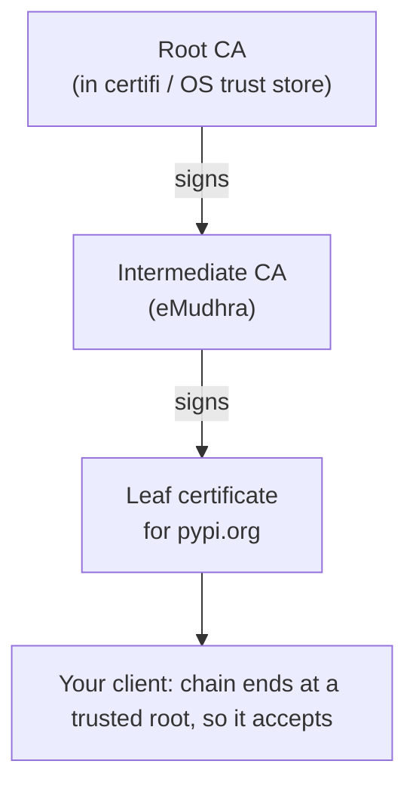
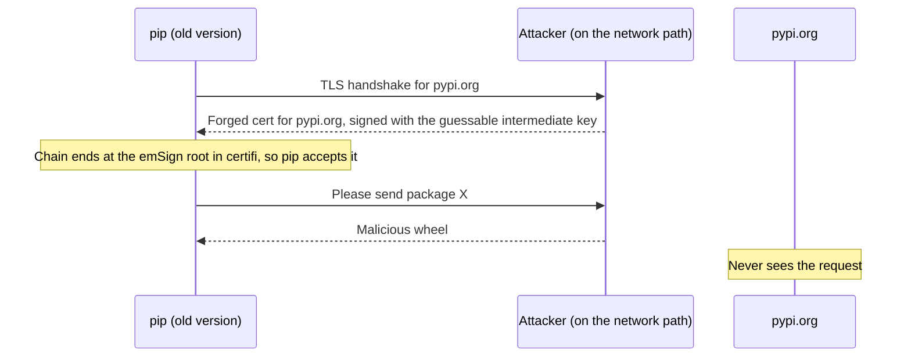
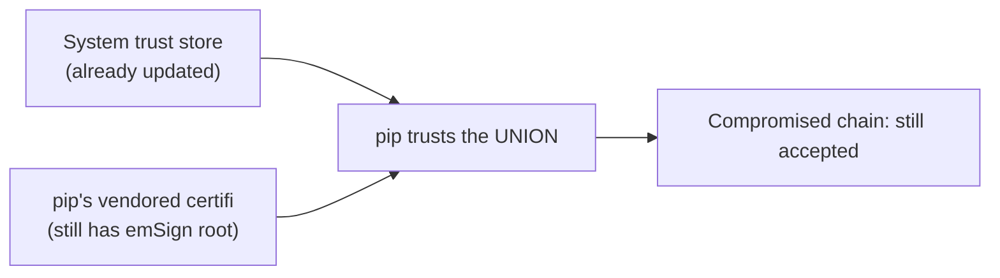

# The eMudhra CA Incident: Your pip Trusted a Key Anyone Could Guess (and How to Patch It)

On October 20, 2026, the Python packaging team published an urgent notice: the **emSign root CA** had to be removed from CA bundles like `certifi`, because intermediate certificates under it were compromised. If your tools still trust it, someone on your network path could impersonate `pypi.org` and hand you a malicious package.

This post explains the incident in plain terms, shows why **upgrading pip is the only real fix for pip itself**, and gives you a patch checklist for laptops, virtualenvs, containers, and CI.

> **Status:** this is a live incident. Everything here comes from the [official Python discussion thread](https://discuss.python.org/t/information-for-python-users-regarding-emudhra-emsign-ca-certificate-security-incident/109576), which its author says will keep being updated. Check it for newer versions before you act.

## 1. What Is a CA, and Why Does One Bad Key Matter?

When your client opens `https://pypi.org`, the server shows a certificate. Your client does not know that server, so it checks that the certificate was signed by a chain of authorities that ends at a **root CA it already trusts**. Those trusted roots live in a **trust store**: the OS store, or a bundle like `certifi`.

A **CA** is just an entity whose signature your client has decided to believe. Intermediate CAs sit between the root and the website certificate, and the root signs them so it doesn't have to stay online.



The whole system rests on one rule: **only the CA can produce its signatures, because only the CA holds the private key.** If anyone else can get that key, they can sign a certificate for any domain, and your client will accept it.

## 2. The Incident: A Private Key You Can Guess

According to the discussion, the "security incident" is a **bad private key**. An elliptic-curve private key is a number, `d`, and the public key (which is published inside the certificate) is computed as `Q = d × G`, where `G` is a fixed public point.

Normally `d` is a huge random number, around 2²⁵⁶, so working backwards from `Q` is infeasible. In this incident, the private value was reported as `d = 4`, and all 8 eMudhra CAs had `d < 256`.

| | Healthy CA key | eMudhra's keys |
|---|---|---|
| Private value `d` | Random, about 2²⁵⁶ possibilities | Less than 256 |
| Finding `d` from the public key | Not feasible | Try 256 values; instant on any laptop |
| Who can sign as the CA | Only the CA | **Anyone who reads the public certificate** |

So the keys were disclosed as compromised and revoked. The real problem is that **revocation of an intermediate doesn't reliably reach applications**. Removing trust is the job of root stores (certifi, Mozilla, the OS), and updates lag. Until your tool gets the new bundle, it still completes handshakes through the known-bad key.

## 3. What an Attacker Gets

An attacker doesn't need to hack PyPI. They need to sit on your network path (café Wi-Fi, a compromised router, a hostile corporate proxy) and answer your connection with a forged certificate.



This is a classic man-in-the-middle attack, and the target is the tool that installs code on your machine. That is why the Python team treated it as urgent.

## 4. Why "Just Fix the OS" Doesn't Work for pip

This is the most important technical point in the thread.

Pip loads the CA certificates from its **own vendored copy of certifi** in addition to the system trust store, and there is no supported way to turn that off. `--cert` and `REQUESTS_CA_BUNDLE` only add CAs, they never remove any.



So with any pip older than **26.2.2**, distrusting the CA at the OS level is not enough, because the vendored bundle still trusts it. Updating pip is the only reliable fix.

How the common tools decide who to trust:

| Tool | Where trust comes from | What to do |
|---|---|---|
| **pip** | Vendored certifi **plus** system store | Upgrade to **26.2.2+** (no workaround) |
| **uv** | Embedded roots by default; system store with `UV_SYSTEM_CERTS=true` | Upgrade to **0.13.4+** |
| **requests / httpx** | `certifi` | Upgrade **certifi** to 2026.10.19+ |
| **httpx2** | OS trust store (via `truststore`) | Make sure your OS / `ca-certificates` is updated |
| **python.org macOS installer** | Bundles certifi | Upgrade pip, then certifi (section 6) |
| **sigstore / pixi** | Own bundles | sigstore **4.5.1+**, pixi **0.82.1+** |

I haven't verified every third-party library's trust source myself. The pip and uv rows come straight from the thread; for anything else, check which bundle it loads.

## 5. Minimum Safe Versions

| Package | Upgrade to at least |
|---|---|
| `certifi` | **2026.10.19** |
| `pip` | **26.2.2** |
| `uv` | **0.13.4** |
| `sigstore` | **4.5.1** |
| `pixi` | **0.82.1** |

The certifi advisory mentions 2026.10.18, but **2026.10.19** is the recommended one, for compatibility with emSign roots that are not affected.

## 6. How to Patch It

### Step 1: Upgrade pip Without Trusting the Network

You can't safely download a fix over a connection you don't trust. The trick is a **direct URL with a SHA-256 hash**. Pip verifies the file's hash, so a MITM can't swap in a different wheel, whatever the TLS layer says:

```shell
python -m pip install "pip @ https://files.pythonhosted.org/packages/3f/06/3e4420302363fbb71be3c7f35ce042f54bfca330e3e66b3a2e3c4cca579f/pip-26.2.2-py3-none-any.whl#sha256=fd7f4dfa8190e014013b9f08f3e973f4e4c26ffd179a204895533a7254813a70"
```

Compare the URL and hash with the official thread before you run it. On Windows, use `py -m pip install ...` with the same argument.

From this secure pip, you can bootstrap the rest:

```shell
python -m pip install --upgrade certifi
```

### Step 2: Upgrade uv

```shell
UV_SYSTEM_CERTS=true uv self update
```

This makes uv use your **system** trust store instead of its embedded bundle. It only helps if your system certificates are already updated: automatic on macOS and Windows, and on Linux it depends on your distribution and whether `ca-certificates` has been updated. Debian, for example, patches its packaged pip to use the system store and shipped a `ca-certificates` update.

### Step 3: macOS python.org Installs

The python.org macOS installer includes certifi, so patch pip first and then certifi (adjust the version path for your install):

```shell
/Library/Frameworks/Python.framework/Versions/3.15/bin/python3.15 -m pip install "pip @ https://files.pythonhosted.org/packages/3f/06/3e4420302363fbb71be3c7f35ce042f54bfca330e3e66b3a2e3c4cca579f/pip-26.2.2-py3-none-any.whl#sha256=fd7f4dfa8190e014013b9f08f3e973f4e4c26ffd179a204895533a7254813a70"
/Library/Frameworks/Python.framework/Versions/3.15/bin/python3.15 -m pip install --upgrade certifi
```

### Step 4: Every Virtualenv on Your Machine

Each virtualenv has its own pip, so fixing the system pip does nothing for them. Community scripts in the thread find every `pyvenv.cfg` under your home directory and upgrade the pip inside each. They download the wheel once, check its hash, and then install it offline with `--no-index`. Read any script before running it. They skip Python older than 3.10, because pip 26.2.2 doesn't support those versions.

The core of the idea:

```shell
# for each virtualenv's python:
"$PY" -I -m pip --isolated install --no-index --no-deps --upgrade pip-26.2.2-py3-none-any.whl
```

### Step 5: New Virtualenvs and `ensurepip`

`python -m venv` creates environments using the pip bundled with your Python (via `ensurepip`), so every new venv can start vulnerable.

- **Python 3.15.1, 3.14.9 and 3.13.17** are out, with updated pip and certifi.
- **3.11 and 3.12** are not getting a release for this. Upgrade pip right after creating each venv, or replace the wheel that `ensurepip` bundles (the thread describes it as copying the new wheel in and making a one-character edit to `ensurepip/__init__.py`).

### Step 6: Containers

Rebuild your images. At the time of the thread, the Docker official `python` images still shipped pip 26.2.1 (tracked in [docker-library/python#1142](https://github.com/docker-library/python/issues/1142)). Don't wait; add the secure upgrade to your Dockerfile and fail the build if it didn't work:

```dockerfile
FROM python:3.14-slim

RUN python -m pip install "pip @ https://files.pythonhosted.org/packages/3f/06/3e4420302363fbb71be3c7f35ce042f54bfca330e3e66b3a2e3c4cca579f/pip-26.2.2-py3-none-any.whl#sha256=fd7f4dfa8190e014013b9f08f3e973f4e4c26ffd179a204895533a7254813a70" \
 && python -m pip install --upgrade certifi
```

One workaround from the thread was setting `PIP_CERT` to the system bundle. Based on the point in section 4, that only **adds** trust and doesn't remove the vendored certifi, so don't rely on it as the fix.

### Step 7: CI and Lockfiles

- Pin minimums in your constraints: `pip>=26.2.2`, `certifi>=2026.10.19`.
- If you use **dependency cooldowns** (waiting N days before adopting new releases), you stay vulnerable until you override them for this fix.
- For building wheels, cibuildwheel **4.3.3** is out. Python 3.9 uses a pip that is still vulnerable, so build with uv and set a minimum.

## 7. Verify It Worked

Here is a small script that fails with a non-zero exit code when pip or certifi are too old, so you can drop it into CI:

```python
import re
import sys
from importlib import metadata

MINIMUMS = {"pip": (26, 2, 2), "certifi": (2026, 10, 19)}


def parse(version: str) -> tuple[int, ...]:
    return tuple(int(n) for n in re.findall(r"\d+", version)[:3])


bad = False
for name, minimum in MINIMUMS.items():
    try:
        found = metadata.version(name)
    except metadata.PackageNotFoundError:
        print(f"{name}: not installed (skipped)")
        continue
    ok = parse(found) >= minimum
    bad |= not ok
    print(f"{name} {found}: {'OK' if ok else 'VULNERABLE'}")

sys.exit(1 if bad else 0)
```

Run it with each interpreter you care about, including the ones inside containers and virtualenvs:

```shell
python check_ca_incident.py
```

## 8. A Defense-in-Depth Fix Is on the Way

Go has released a mitigation that blocks the compromised intermediates by **SPKI hash** (a fingerprint of the public key). The same idea has been proposed for CPython's `ssl` module ([issue #160040](https://github.com/python/cpython/issues/160040)): a small denylist checked during certificate verification, so connections fail even when the OS, certifi, or pip is out of date. At the time of writing it is a proposal, not a shipped feature, and `CERT_NONE` would not be affected.

## Helpful Tools

- **[The official Python thread](https://discuss.python.org/t/information-for-python-users-regarding-emudhra-emsign-ca-certificate-security-incident/109576)**: the source of truth for versions and updates.
- **`python -m pip --version`**: the fastest way to check one environment.
- **`openssl s_client -connect pypi.org:443 -showcerts`**: see the certificate chain a server really presents.
- **`uv`**: with `UV_SYSTEM_CERTS=true`, it uses your updated OS store.
- **[eMudhra Intermediate CA Compromise](https://emudhra.we-have-a-problem.com/)**

## Summary

A group of eMudhra intermediate CA keys were trivially guessable (`d < 256`), so anyone could forge certificates that chain to a root many tools trusted. Browsers and operating systems are fixed by updating the trust store, but **pip carries its own certifi and always trusts it on top of the system store**, so only pip **26.2.2+** closes the hole. Bootstrap the upgrade with a hash-pinned direct URL so you never depend on a connection you can't trust, then upgrade `certifi` (2026.10.19), `uv` (0.13.4), rebuild your containers, fix every virtualenv, and add a version check to CI. Treat it like any supply-chain incident: patch the tool that installs your code first.

<meta name="fediverse:creator" content="@kg@fosstodon.org">
